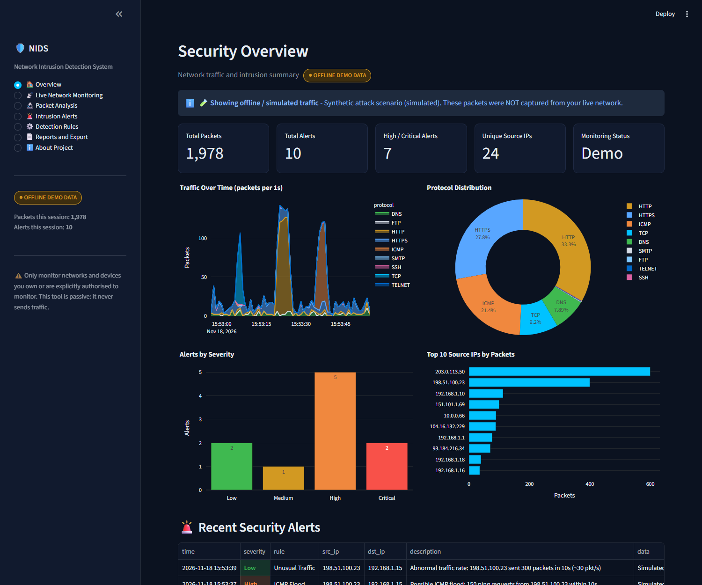

# 🛡️ Network Intrusion Detection System (NIDS)

A Python-based, rule-driven **Network Intrusion Detection System** that captures network
packets, analyses them, detects suspicious activity (port scans, SYN floods, ICMP floods,
watch-listed IPs, abnormal traffic rates) and presents security alerts on an interactive
Streamlit dashboard. Alerts are stored in SQLite and can be filtered, searched and exported.

**Repository:** https://github.com/tishaa-ai/Network-Intrusion-Detection-System

It works in two modes:

* **Live monitoring** – real packet capture with Scapy (requires Npcap on Windows).
* **Offline demo mode** – replays simulated traffic, a sample CSV or a real PCAP file through
  the **same detection engine**. No admin rights, no Npcap, no network traffic sent.



---

## 1. Problem Statement

Organisations are constantly probed and attacked over the network. Firewalls block known-bad
ports, but they don't tell an analyst *what is happening* on the network. A SOC (Security
Operations Centre) needs visibility: who is scanning us, is a host being flooded, is an
internal machine talking to a known-malicious server?

A **NIDS** passively watches traffic and raises alerts when it sees patterns that match
known attack behaviour, so analysts can investigate and respond.

## 2. Objectives

1. Capture live packets and decode IPs, ports, protocols and timestamps.
2. Detect common attacks with configurable, explainable rules.
3. Assign each alert a severity (Low / Medium / High / Critical), description and timestamp.
4. Store alerts persistently (SQLite) and allow filtering, searching and CSV export.
5. Provide a professional dashboard for monitoring.
6. Work fully offline for demonstration, without faking any results.

## 3. Technologies Used

| Technology | Purpose |
|---|---|
| Python 3.12 | Core language |
| Scapy | Live packet capture, PCAP reading, packet decoding |
| Streamlit | Interactive web dashboard |
| Pandas | Data processing / tables |
| Plotly | Interactive charts |
| SQLite (`sqlite3`) | Alert storage (built into Python) |
| `logging` | Application logs (`logs/nids.log`) |
| pytest | Automated tests |

## 4. System Architecture

```
 ┌─────────────────────┐   ┌──────────────────┐   ┌──────────────────────┐   ┌──────────┐   ┌─────────────┐
 │ Packet sources      │   │ Packet Analyzer  │   │ Detection Engine     │   │ SQLite   │   │ Streamlit   │
 │ • Live (Scapy)      │──►│ raw packet  ──►  │──►│ • Port Scan          │──►│ alerts   │──►│ dashboard   │
 │ • PCAP file         │   │ PacketInfo       │   │ • SYN Flood          │   │ table    │   │ + Plotly    │
 │ • CSV file          │   │ (ip, ports,      │   │ • ICMP Flood         │   └──────────┘   └─────────────┘
 │ • Traffic simulator │   │  protocol, flags)│   │ • Suspicious IP      │
 └─────────────────────┘   └──────────────────┘   │ • Unusual Traffic    │
                                                  └──────────────────────┘
          all sources go through NIDSMonitor.ingest()  →  same engine for live and demo
```

### Project structure

```
Network-Intrusion-Detection-System/
├── app.py                     # Streamlit dashboard (7 pages)
├── config.py                  # ALL thresholds, severities, paths, watch-list
├── database.py                # SQLite alert storage, filtering, CSV export
├── generate_sample_data.py    # Regenerates data/sample_traffic.csv + .pcap
├── requirements.txt
├── detection/
│   ├── base.py                # Alert, SlidingWindow, DetectionRule base class
│   ├── engine.py              # Runs every rule on every packet
│   ├── port_scan.py
│   ├── syn_flood.py
│   ├── icmp_flood.py
│   ├── suspicious_ip.py
│   └── unusual_traffic.py
├── monitoring/
│   ├── packet_analyzer.py     # Scapy packet -> PacketInfo
│   ├── packet_capture.py      # Live capture with Scapy AsyncSniffer
│   ├── offline_demo.py        # Simulator + CSV/PCAP loaders
│   └── monitor.py             # Connects capture -> engine -> database
├── dashboard/
│   └── visualizations.py      # Plotly charts
├── utils/
│   └── logger.py              # Console + rotating file logs
├── data/
│   ├── sample_traffic.csv     # 2,001 sample packets (simulated)
│   └── sample_traffic.pcap    # same traffic as a real PCAP (open in Wireshark)
├── docs/screenshots/          # Screenshots of every page
├── tests/
│   ├── conftest.py
│   ├── test_detection.py      # 19 detection / analyzer tests
│   ├── test_database.py       # 13 storage / export / monitor tests
│   └── test_live_capture.py   # 30 live capture -> engine -> dashboard tests
└── .streamlit/config.toml     # Dark theme
```

## 5. Features

### A. Network traffic monitoring
* Live capture via Scapy with interface selection (Wi-Fi/Ethernet preselected) and optional
  BPF filter (`tcp or icmp`).
* Shows timestamp, source/destination IP and port, protocol, TCP flags, size, summary.
* Protocols identified: TCP, UDP, ICMP, DNS, HTTP, HTTPS, SSH, FTP, SMTP, Telnet, RDP, ARP.
* Start / Stop buttons; the page auto-refreshes every 2 s while capturing, showing packets
  analysed, packets/second, frames received and this session's alerts in real time.
* Detects an interrupted capture (Wi-Fi disconnected, laptop asleep) and says so.
* An authorisation checkbox must be ticked before capture can start.

### B. Intrusion detection engine
Each rule counts events **per source** inside a **sliding time window**:

| Rule | Logic | Default threshold | Severity |
|---|---|---|---|
| **Port Scan** | Distinct destination ports contacted (TCP SYN / UDP) from one source to one host | 15 ports in 10 s | High (Critical ≥ 45) |
| **SYN Flood** | TCP packets with SYN set and ACK **not** set from one source | 100 in 10 s | High (Critical ≥ 300) |
| **ICMP Flood** | ICMP Echo Requests (type 8) from one source | 50 in 10 s | Medium (High ≥ 150) |
| **Suspicious IP** | Source **or** destination IP is on the watch-list | first packet | High |
| **Unusual Traffic** | Total packets of any kind from one source | 300 in 10 s | Low (Medium ≥ 900) |

* **Escalation:** if the count reaches `threshold × escalation_factor` (default 3), severity
  goes up one level.
* **Cooldown:** after alerting, a rule stays quiet for the same source for 30 s (unless the
  severity escalates) so one attack doesn't create hundreds of duplicate alerts.
* **Modular:** to add a rule, subclass `DetectionRule`, implement `inspect()`, add default
  settings in `config.py` and register it in `ALL_RULE_CLASSES` in `detection/engine.py`.
* All thresholds, windows, severities and the watch-list are editable live on the
  **Detection Rules** page.

### C. Security dashboard (7 pages)
1. **Overview** – total packets, total alerts, high/critical alerts, unique source IPs,
   monitoring status, traffic over time, protocol distribution, alerts by severity, top
   talkers, recent alerts, suspicious source IPs.
2. **Live Network Monitoring** – live capture tab + offline demo tab.
3. **Packet Analysis** – filter packets by protocol / IP / port, charts, CSV download.
4. **Intrusion Alerts** – filter by severity and detection type, search by IP, timeline,
   evidence details, CSV export, clear alerts.
5. **Detection Rules** – tune every rule.
6. **Reports and Export** – summary tables, CSV export, text incident report.
7. **About Project**.

### D. Alert management
SQLite table `alerts` (`data/nids_alerts.db`) with time, rule, severity, source/destination IP,
description, evidence details and data source (Live / Simulated / Offline PCAP). All queries
use parameterised SQL (safe from SQL injection).

### E. Offline demo mode
Alerts are **never hardcoded**. The demo feeds packets into the real detection engine:

| Source | What it does |
|---|---|
| Synthetic generator | Builds ~2,000 realistic packets in memory (nothing is sent) |
| Sample CSV file | Replays `data/sample_traffic.csv` |
| Sample PCAP file | Decodes `data/sample_traffic.pcap` with Scapy (real packet parsing) |
| Upload my own file | Any `.pcap/.pcapng` (e.g. saved from Wireshark) or CSV |

Demo scenario (60 s of traffic):

| Time | Event | Expected alert(s) |
|---|---|---|
| 0–60 s | Normal web, DNS, ping traffic from 16 LAN hosts | none (no false positives) |
| every 8 s | `192.168.1.12` beacons to watch-listed `203.0.113.66:4444` | Suspicious IP (High) |
| 10 s | `10.0.0.66` SYN-scans 90 ports on `192.168.1.10` | Port Scan High → Critical |
| 25 s | `203.0.113.50` sends 600 SYNs to `192.168.1.20:80` in 5 s | SYN Flood High → Critical, Unusual Traffic |
| 40 s | `198.51.100.23` sends 400 pings to `192.168.1.15` in 4 s | ICMP Flood Medium → High, Unusual Traffic |

All simulated data is labelled **"OFFLINE DEMO DATA"** / "Simulated" in the UI and in the
`traffic_source` column of every alert. The demo uses private and RFC 5737 documentation IP
ranges that are never routed on the internet.

---

## 6. Installation on Windows (VS Code)

### Prerequisites
* **Python 3.12** (3.11 also fine) – https://www.python.org/downloads/ – tick
  *"Add python.exe to PATH"* during setup.
* VS Code with the Python extension.
* *(Only for live capture)* **Npcap** – see section 9.
* *(Only to clone)* **Git for Windows** – https://git-scm.com/download/win

Get the code, either by cloning it:

```powershell
git clone https://github.com/tishaa-ai/Network-Intrusion-Detection-System.git
cd Network-Intrusion-Detection-System
```

or with **Code → Download ZIP** on the GitHub page (then extract it).

Open the project folder in VS Code, then open a terminal (**Terminal → New Terminal**,
PowerShell) and run:

```powershell
# 1. Go to the project folder (skip if you just cloned it)
cd "$HOME\OneDrive\Desktop\Network-Intrusion-Detection-System"

# 2. Create a virtual environment (use Python 3.12)
py -3.12 -m venv .venv

# 3. Activate it
.\.venv\Scripts\Activate.ps1
```

> If PowerShell says *"running scripts is disabled on this system"*, run this once and
> then activate again:
> ```powershell
> Set-ExecutionPolicy -Scope CurrentUser -ExecutionPolicy RemoteSigned
> ```
> (Using Command Prompt instead? Activate with `.venv\Scripts\activate.bat`.)

```powershell
# 4. Install dependencies
python -m pip install --upgrade pip
pip install -r requirements.txt
```

## 7. Running the Project

```powershell
# Start the dashboard
streamlit run app.py
```

Open **http://localhost:8501** in your browser. (Stop the server with `Ctrl + C`.)

### Run the tests
```powershell
python -m pytest -v
```
Expected: **61 passed, 1 skipped**. The skipped test captures from your real network adapter;
run it on purpose (needs Npcap, see section 9):

```powershell
$env:NIDS_LIVE_TEST = "1"; python -m pytest tests/test_live_capture.py -k real -v; Remove-Item Env:NIDS_LIVE_TEST
```
It makes one DNS lookup and one HTTP request to `example.com`, watch-lists that IP for the
test only and checks that a live **Suspicious IP** alert is raised and stored.

### Regenerate the sample data (optional)
```powershell
python generate_sample_data.py
```

## 8. Using Offline Demo Mode (no admin, no Npcap)

1. Run `streamlit run app.py` and open http://localhost:8501.
2. On **Overview**, click **"Run offline demo now"** – or go to
   **Live Network Monitoring → Offline Demo Mode**, choose a source, click **Run Offline Demo**.
3. Explore **Overview**, **Packet Analysis**, **Intrusion Alerts** and **Reports**.
4. Try tuning: on **Detection Rules** set SYN Flood threshold to 1000 → *Apply Rules* → re-run
   the demo – the SYN Flood alert disappears. This proves alerts come from live logic.

## 9. Live Monitoring on Windows (Npcap)

### 9.1 Install and check Npcap
1. Download Npcap from https://npcap.com (the same driver Wireshark uses) and run the
   installer. Tick **"Install Npcap in WinPcap API-compatible Mode"**.
   * **"Restrict Npcap driver's access to Administrators only"** - if you tick it, you must
     start VS Code / the terminal with **Run as administrator**. If you leave it unticked,
     normal user rights are enough.
2. Close and reopen the terminal (so the new driver is picked up), activate `.venv`.
3. Check that Npcap is running and that Scapy can see your adapters:

```powershell
Get-Service npcap                       # Status should be "Running"
python -c "from monitoring.packet_capture import check_capture_support, list_interfaces; print(check_capture_support()); [print(i['label']) for i in list_interfaces()]"
```

You should see `(True, 'Packet capture driver available.')` and your adapters, best first,
for example:

```
Wi-Fi - Example 802.11ac Wireless LAN Adapter [192.168.1.50, connected] (default route, wireless)
Bluetooth Network Connection - Bluetooth Device (Personal Area Network) [169.254.10.20, not connected] (wireless)
...
```

### 9.2 Capture from the dashboard
1. `streamlit run app.py` and open **Live Network Monitoring → Live Capture**.
2. The **Network interface** list shows each adapter as
   *friendly name - driver [IP, connected/not connected]*. The adapter that carries your
   internet traffic (default route, usually **Wi-Fi** or **Ethernet**) is **preselected**.
   Adapters with no IP or a `169.254.x.x` address are marked *not connected* - they will
   capture little or nothing.
3. Optionally enter a BPF filter such as `tcp or udp or icmp` or `host 192.168.1.10`.
4. Tick the authorisation checkbox and press **Start Monitoring**.
5. The panel refreshes every 2 s: **Packets Analysed**, **Alerts (this session)**,
   **Packets / second**, frames received and non-IP frames skipped (e.g. LLDP, 802.1X), the
   **real-time alerts** table, a traffic chart and the latest packets. Every page (Overview,
   Packet Analysis, Intrusion Alerts, Reports) shows the live data too.
6. Press **Stop Monitoring** to stop.

**Quick way to see a live alert on your own machine:** on **Detection Rules**, add the IP of a
site you control or `example.com` (`nslookup example.com`) to *Suspicious IPs*, press
*Apply Rules*, start monitoring and open that site - a **Suspicious IP** alert appears within
a couple of seconds. Normal browsing alone should produce **no** alerts.

### 9.3 How it works
Scapy's `AsyncSniffer` runs in a background thread. For every frame it calls
`PacketCapture._handle()` → `analyze_packet()` → `NIDSMonitor.ingest()` →
`DetectionEngine.process_packet()` - **exactly the same `ingest()` the offline demo uses**, so
live and offline traffic go through identical rules. Alerts are written to SQLite immediately.

In code (e.g. a script), any Windows interface name works - friendly name, driver
description or Npcap id:

```python
from monitoring.monitor import NIDSMonitor
monitor = NIDSMonitor()
monitor.start_live("Wi-Fi", "tcp or udp or icmp")   # or None = recommended adapter
...
print(monitor.status())                              # counts, rate, last error
monitor.stop_live()
```

### 9.4 Troubleshooting

| Message / symptom | Cause | Fix |
|---|---|---|
| *Npcap was not found* | Npcap not installed, or terminal opened before install | Install Npcap, reopen the terminal, `Get-Service npcap` must be *Running* (`Start-Service npcap` as admin). |
| *Permission denied. Run VS Code / the terminal as Administrator...* | Npcap installed with *Administrators only* | Run VS Code as administrator, or reinstall Npcap with that option unticked. |
| *Network interface 'X' was not found. Available interfaces: ...* | Wrong name typed in code | Use one of the listed names, e.g. `"Wi-Fi"`. |
| *The network adapter could not be opened* | Adapter disabled / unplugged | Enable it in *Settings → Network*, choose it again. |
| *Invalid BPF capture filter* | Filter syntax error | e.g. `tcp or icmp`, `port 53`, `host 10.0.0.5`; or leave empty. |
| *No packets received yet* warning | Wrong adapter selected | Pick the *connected* adapter (Wi-Fi/Ethernet). |
| Red **CAPTURE INTERRUPTED** badge | Wi-Fi dropped, laptop slept, driver reset | Reconnect, press **Start Monitoring** again. Packets and alerts captured so far are kept. |

> ⚠️ **Only capture traffic on networks and devices you own or have explicit written
> permission to monitor.** This tool is passive – it never sends packets.

Without Npcap the dashboard shows a clear message and disables the Start button; everything
else (offline demo, alerts, reports) keeps working.

## 10. Sample Alerts and Their Meaning

| Severity | Rule | Example description | What it means / analyst action |
|---|---|---|---|
| High | Port Scan | `Possible port scan: 10.0.0.66 probed 15 different ports on 192.168.1.10 within 10s` | Reconnaissance – someone is mapping open services. Check if the source is an authorised scanner; otherwise block it and review the target for exposed services. |
| Critical | Port Scan | `... probed 45 different ports ...` | Aggressive, fast scan. Likely automated tool (e.g. Nmap). |
| High | SYN Flood | `Possible SYN flood: 100 TCP SYN packets from 203.0.113.50 within 10s` | DoS attempt filling the server's half-open connection table. Rate-limit / enable SYN cookies / block source. |
| Critical | SYN Flood | `... 300 TCP SYN packets ...` | Flood is intensifying – escalate to incident response. |
| Medium | ICMP Flood | `Possible ICMP flood: 50 ping requests from 198.51.100.23 within 10s` | Ping flood – bandwidth/CPU exhaustion attempt. Rate-limit ICMP at the firewall. |
| High | Suspicious IP | `Traffic outbound to watch-listed IP 203.0.113.66 (TCP port 4444)` | An internal host is contacting a known-bad server – possible malware/C2 beacon. Isolate and investigate the internal host. |
| Low | Unusual Traffic | `Abnormal traffic rate: 203.0.113.50 sent 300 packets in 10s (~30 pkt/s)` | Volume anomaly – not necessarily malicious (backup, update) but worth a look. |

## 11. Limitations

* **Rule/threshold-based** – detects known patterns only; novel attacks (zero-days) and
  low-and-slow attacks that stay under thresholds are missed.
* **Per-source counting** – a distributed (DDoS) or spoofed-source SYN flood spread across
  many IPs may stay under each per-source threshold.
* **No payload inspection of encrypted traffic** – HTTPS content is not visible (by design).
* **Single machine** – sees only the traffic reaching this computer's network card (on a
  switched network that's mostly your own traffic, unless using a SPAN/mirror port).
* **Python performance** – fine for a laptop/small network (thousands of packets/s), not
  for multi-gigabit links.
* Packets are kept in memory (last 50,000); alerts are persistent in SQLite.
* Live capture was verified on Windows 11 with Npcap and Scapy 2.8.0 on a Wi-Fi adapter
  (real packets analysed, live alert raised and stored). Permission-denied and
  adapter-disconnect handling is covered by automated tests that simulate those errors.
* On Wi-Fi, Windows normally only delivers this computer's own traffic (no monitor mode).

## 12. Future Enhancements

* Machine-learning anomaly detection (e.g. Isolation Forest on traffic features, trained on
  the CIC-IDS2017 / NSL-KDD datasets).
* Per-destination flood detection for distributed attacks.
* Threat-intelligence feed integration (AbuseIPDB, AlienVault OTX) for the watch-list.
* Signature rules similar to Snort/Suricata (payload pattern matching).
* Email / Slack / Teams notifications for Critical alerts.
* Forward alerts to a SIEM (Splunk, ELK, Wazuh) via syslog or JSON.
* GeoIP map of attacking IPs.
* User authentication on the dashboard and Docker deployment.
* MITRE ATT&CK mapping (Port Scan → T1046 Network Service Discovery, Floods → T1498 Network
  Denial of Service).

## 13. Screenshots

| Page | File |
|---|---|
| Overview | `docs/screenshots/01_overview.png` |
| Offline demo | `docs/screenshots/02_offline_demo.png` |
| Live capture | `docs/screenshots/03_live_capture.png` |
| Packet analysis | `docs/screenshots/04_packet_analysis.png` |
| Intrusion alerts | `docs/screenshots/05_intrusion_alerts.png` |
| Detection rules | `docs/screenshots/06_detection_rules.png` |
| Reports & export | `docs/screenshots/07_reports_and_export.png` |

## 14. Safety & Ethics

* Passive monitoring only – no packets are ever sent, no exploit code is included.
* The sample PCAP/CSV is **generated** (writing a file sends nothing).
* Monitor only networks you own or are authorised to monitor. Unauthorised interception of
  network traffic may be illegal.

## 15. Third-Party Software and Licences

This repository contains no third-party source code. The libraries below are installed
from PyPI via `requirements.txt` and keep their own licences (versions as tested):

| Package | Version | Licence |
|---|---|---|
| Scapy | 2.8.0 | GPL-2.0-only |
| Streamlit | 1.67.0 | Apache-2.0 |
| pandas | 3.1.1 | BSD-3-Clause |
| Plotly | 7.1.0 | MIT |
| pytest | 9.2.0 | MIT |

Npcap (needed for live capture on Windows) is a separate download from https://npcap.com
under its own licence. It is not redistributed with this project.
